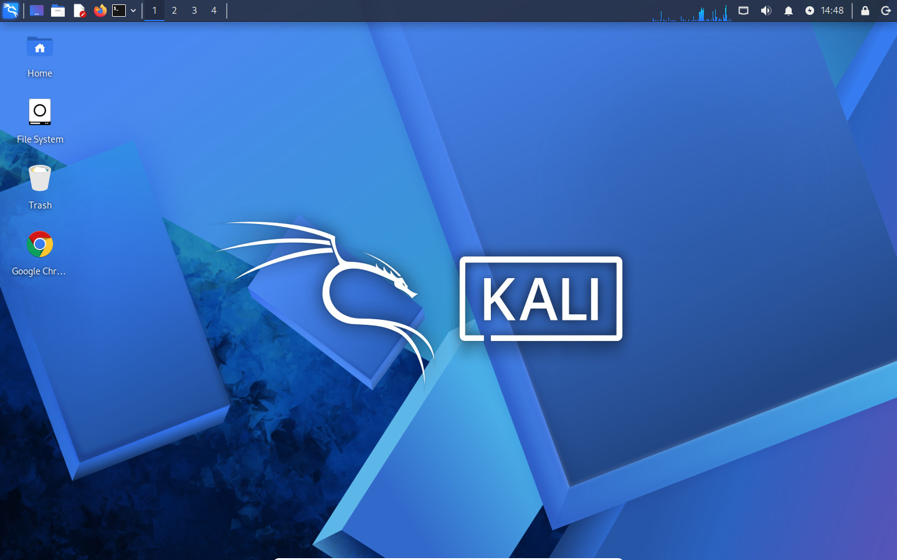
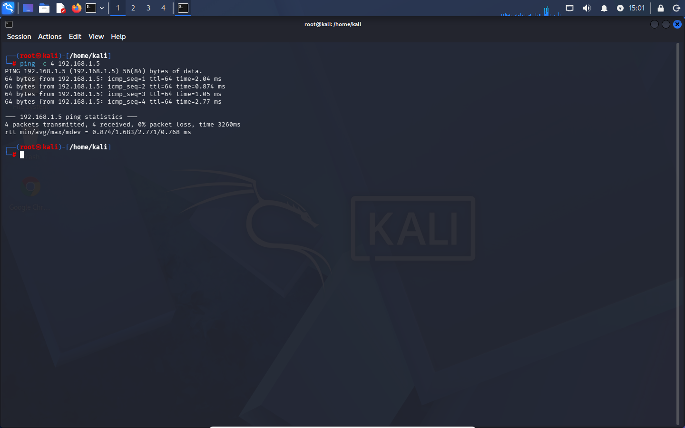
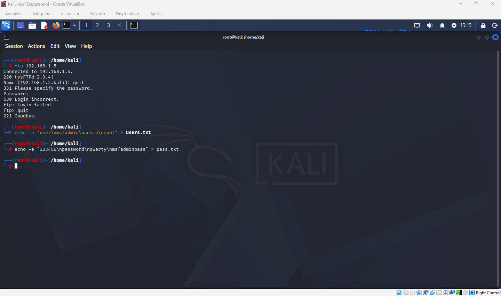
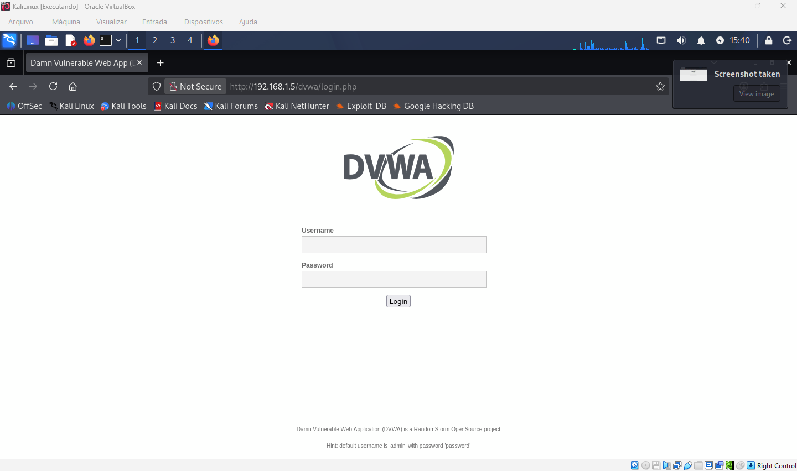
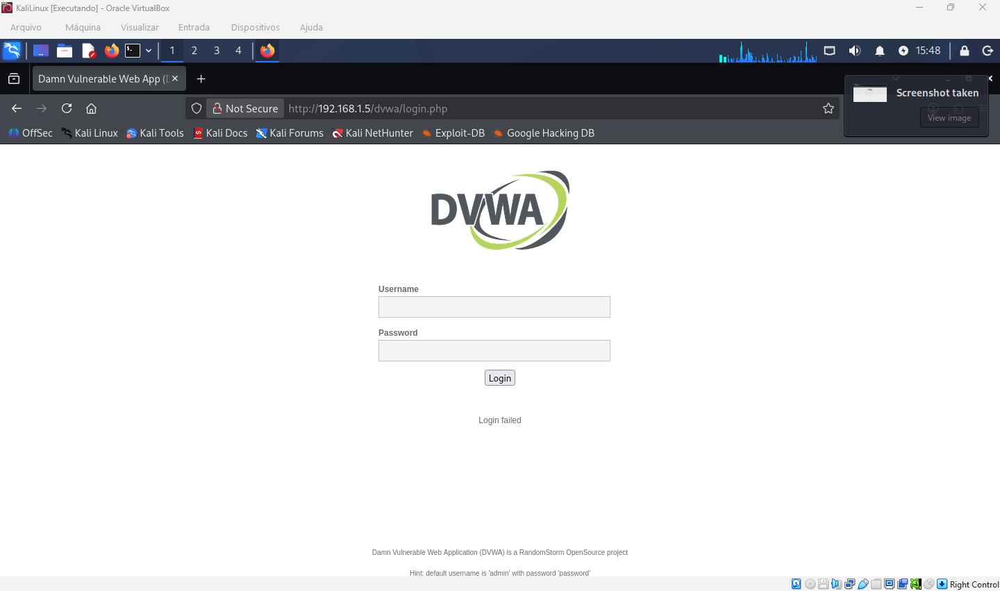
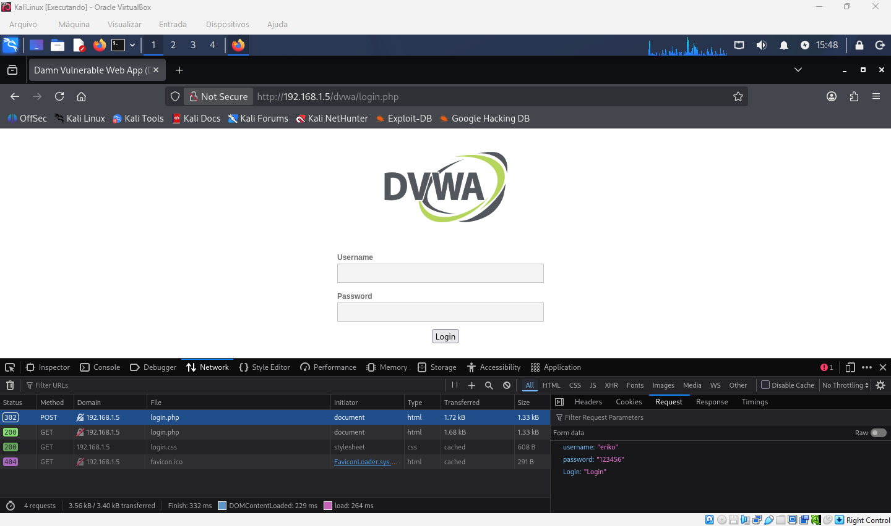
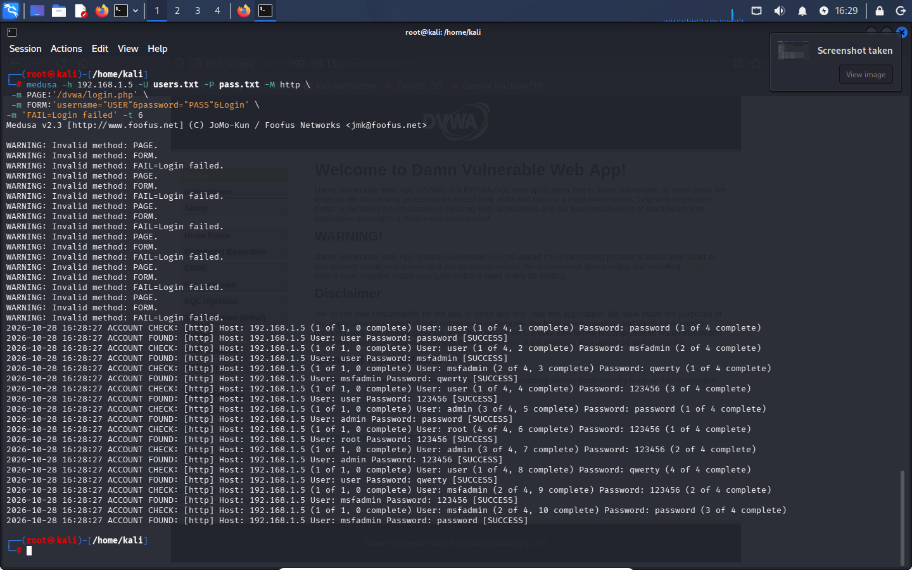
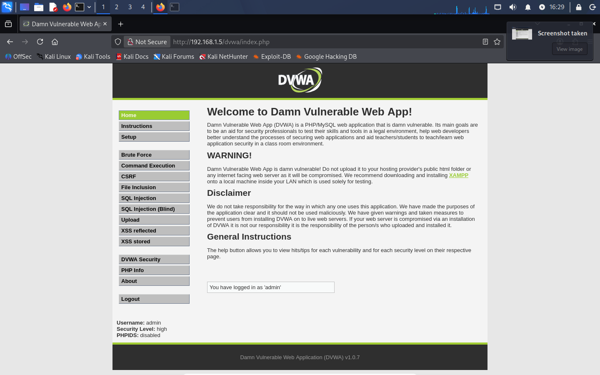
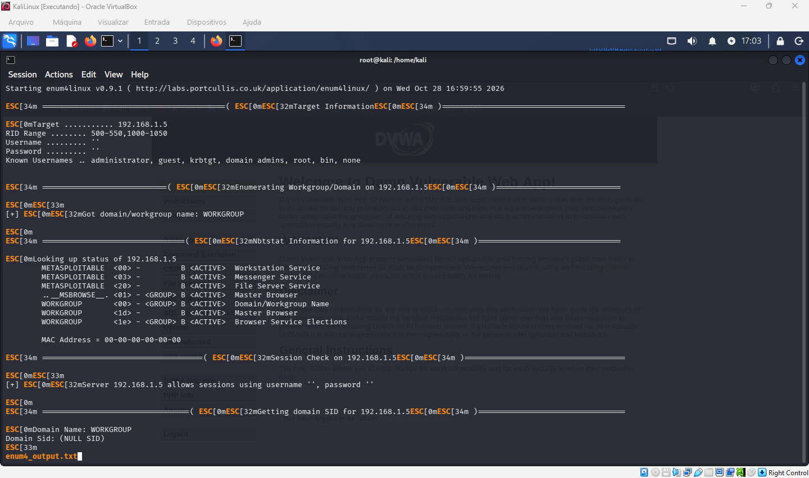
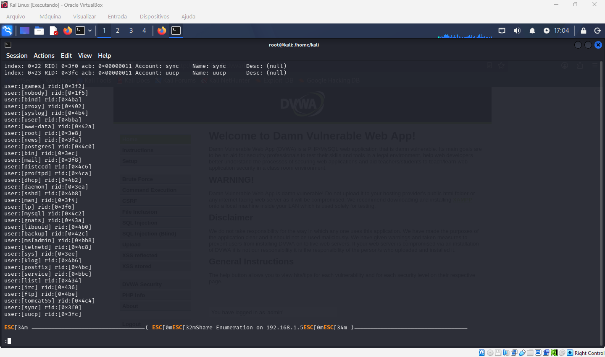

# Laboratório prático de segurança ofensiva e defensiva | DIO

> **Ambiente controlado e finalidade educacional.** Este projeto documenta testes realizados em máquinas virtuais próprias: Kali Linux e Metasploitable 2. Os procedimentos não devem ser executados contra sistemas de terceiros sem autorização explícita.

## Objetivo

Aprender, na prática, a reconhecer serviços expostos, identificar riscos de autenticação, interpretar resultados de ferramentas e propor medidas de proteção e monitoramento para um SOC/Blue Team. O registro inclui tanto sucessos quanto erros e ajustes encontrados durante os exercícios.

## Ambiente e ferramentas

| Componente | Uso |
|---|---|
| Oracle VirtualBox | Virtualização do laboratório |
| Kali Linux | Estação de testes |
| Metasploitable 2 (`192.168.1.5`) | Alvo deliberadamente vulnerável |
| Nmap | Descoberta de serviços e versões |
| FTP | Teste de autenticação de serviço |
| Medusa | Auditoria automatizada de credenciais |
| DVWA | Aplicação web vulnerável de treinamento |
| enum4linux | Enumeração de informações SMB/Samba |
| smbclient | Verificação de autenticação e compartilhamentos SMB |

**Cuidado com a rede:** neste exercício, a VM vulnerável foi colocada em modo **Bridge** para facilitar a comunicação com outras máquinas e um possível monitoramento pelo Wazuh. Isso também pode expô-la à rede local. A opção mais segura para uma VM intencionalmente vulnerável é uma rede isolada (por exemplo, Host-only ou rede interna), com conectividade de monitoramento planejada e controlada.

## 1. Preparação das máquinas virtuais

O Metasploitable 2 utiliza um sistema Linux antigo. No laboratório, foi necessário contornar um problema de inicialização: durante a contagem do GRUB, pressionar `Esc`, selecionar a primeira entrada, pressionar `e`, editar a linha do kernel, acrescentar `noapic`, confirmar com `Enter` e iniciar com `b`. Esse procedimento foi específico para a situação observada e não é uma configuração universal.


*Inicialização do Metasploitable 2 e diagnóstico do ambiente virtual.*

### Kali Linux



*Estação Kali Linux usada nos testes.*

## 2. Teste de conectividade

```bash
ping -c 4 192.168.1.5
```

O parâmetro `-c 4` limita o envio a quatro pacotes ICMP. O retorno observado foi de quatro respostas, sem perda, confirmando conectividade IP naquele momento. Isso não comprova que todos os serviços estejam disponíveis.



*Ping entre Kali Linux e Metasploitable 2.*

## 3. Identificação de portas e serviços com Nmap

```bash
nmap -sV -p 21,22,80,445,139 192.168.1.5
```

- `-sV`: tenta identificar o serviço e sua versão.
- `-p`: define as portas verificadas.
- `192.168.1.5`: IP do alvo no laboratório.

| Porta | Serviço identificado | Versão indicada no laboratório |
|---|---|---|
| 21 | FTP | vsftpd 2.3.4 |
| 22 | SSH | OpenSSH 4.7p1 |
| 80 | HTTP | Apache httpd 2.2.8 |
| 139 e 445 | SMB/Samba | Samba smbd 3.x–4.x (identificação aproximada) |

**Interpretação:** uma porta aberta significa que há um serviço acessível; não significa, por si só, que houve invasão. Serviços antigos e desnecessariamente expostos aumentam a superfície de ataque e devem ser avaliados.

## 4. Acesso e auditoria de autenticação FTP

Primeiro, foi feita uma conexão ao serviço:

```bash
ftp 192.168.1.5
```

O servidor apresentou o banner `220 (vsFTPd 2.3.4)` e solicitou credenciais. Em seguida, foram criadas listas pequenas para um teste didático:

```bash
echo -e "user\nmsfadmin\nadmin\nroot" > users.txt
echo -e "123456\npassword\nqwerty\nmsfadminpass" > pass.txt
```



*Criação das listas de usuários e senhas para o exercício FTP.*

O comando de auditoria foi:

```bash
medusa -h 192.168.1.5 -U users.txt -P pass.txt -M ftp -t 6
```

| Opção | Significado |
|---|---|
| `-h` | Host alvo |
| `-U` | Arquivo com nomes de usuários |
| `-P` | Arquivo com senhas |
| `-M ftp` | Módulo FTP |
| `-t 6` | Até seis tarefas de autenticação simultâneas por host |

O registro final do laboratório exibiu `ACCOUNT FOUND` com usuário `msfadmin` e senha `msfadmin`, além de uma autenticação FTP manual bem-sucedida (`230 Login successful`). **Observação de reprodutibilidade:** a lista `pass.txt` anotada acima continha `msfadminpass`, enquanto a captura de sucesso mostra `msfadmin`. Isso indica que a lista ou o teste foi ajustado entre as etapas; não se deve atribuir o resultado à lista inicial sem essa ressalva.

.png)

*Evidência de credenciais FTP encontradas e validação manual da autenticação.*

## 5. Teste de autenticação na aplicação web DVWA

A aplicação de treinamento estava acessível em:

```text
http://192.168.1.5/dvwa/login.php
```



*Formulário de autenticação do DVWA.*

Uma tentativa manual falhou. Com as ferramentas de desenvolvedor do navegador (`F12`, ou `Fn + F12` conforme o teclado), foi possível observar a requisição HTTP do formulário, incluindo os campos `username`, `password` e `Login`. A resposta HTTP `302` e a mensagem **Login failed** foram utilizadas para entender o comportamento da página.



*Tentativa de login malsucedida no DVWA.*



*Inspeção da requisição do formulário na aba de rede do navegador.*

### Tentativa com Medusa e análise do erro

O comando testado foi:

```bash
medusa -h 192.168.1.5 -U users.txt -P pass.txt -M http \
  -m PAGE:'/dvwa/login.php' \
  -m FORM:'username="USER"&password="PASS"&Login' \
  -m 'FAIL=Login failed' -t 6
```

O terminal apresentou mensagens como `WARNING: Invalid method: PAGE`, `FORM` e `FAIL=Login failed`. Apesar de mostrar várias linhas `ACCOUNT FOUND`, **esses resultados não podem ser tratados como credenciais comprovadas**, pois os parâmetros não foram aceitos corretamente pelo módulo. A lição foi interpretar avisos e validar resultados, em vez de confiar apenas na palavra `SUCCESS`.



*Saída do Medusa HTTP com avisos de métodos inválidos e resultados não confiáveis.*

A autenticação no DVWA foi posteriormente **validada manualmente** com o usuário `admin` e a senha `password`, resultando no acesso à aplicação. Isso **não comprova** que o comando HTTP anterior tenha descoberto corretamente a senha.



*Acesso autenticado ao DVWA após verificação manual das credenciais.*

## 6. Enumeração SMB/Samba com enum4linux

**SMB (Server Message Block)** é um protocolo usado para compartilhar arquivos, impressoras e outros recursos. **Samba** implementa serviços compatíveis com SMB em sistemas Linux/Unix. As portas 139 e 445 encontradas no Nmap motivaram a verificação do serviço.

```bash
enum4linux -a 192.168.1.5 | tee enum4_output.txt
```

- `enum4linux -a`: solicita diferentes verificações de enumeração disponíveis na ferramenta.
- `| tee enum4_output.txt`: exibe a saída na tela e salva uma cópia no arquivo.
- `less enum4_output.txt`: permite ler o relatório salvo; pressione `q` para sair.



*Execução do enum4linux e informações do ambiente SMB.*

O exercício mostrou informações sobre o grupo de trabalho `WORKGROUP`, o host `METASPLOITABLE` e nomes de contas. A possibilidade de obter informações sem autenticação robusta pode facilitar o reconhecimento de um ambiente.



*Lista de usuários enumerados no servidor SMB do laboratório.*

## 7. Auditoria de senhas no SMB com Medusa

### Preparação das wordlists

```bash
echo -e "user\nmsfadmin\nservice" > smb_users.txt
echo -e "password\n123456\nWelcome123\nmsfadmin" > senhas_spray.txt
```

As senhas não foram escolhidas aleatoriamente. `123456` é um exemplo de senha extremamente previsível; `Welcome123` representa o padrão de senha de boas-vindas ou senha temporária que, em alguns ambientes, não é alterada após o primeiro acesso. Em uma auditoria **autorizada**, a seleção de senhas de teste deve respeitar o escopo, a política de senhas, os limites de tentativas e as regras de tratamento de informações eventualmente expostas em incidentes anteriores.

**Conceitos:** força bruta e ataques de dicionário testam combinações de credenciais. *Password spraying*, em sentido estrito, distribui poucas senhas comuns por muitas contas para reduzir o volume de tentativas em cada uma; o comando a seguir percorre combinações das duas listas e não comprova, sozinho, essa cadência específica.

### Execução e correção do nome do arquivo

A primeira tentativa apontava para `senhas_quebradas.txt`, que não existia, e retornou `Failed to open file`. Após verificar os arquivos no diretório, foi utilizado o nome correto:

```bash
medusa -h 192.168.1.5 -U smb_users.txt -P senhas_spray.txt -M smbnt -t 2 -T 50
```

| Opção | Função |
|---|---|
| `-h 192.168.1.5` | Host SMB do laboratório |
| `-U smb_users.txt` | Lista de contas a verificar |
| `-P senhas_spray.txt` | Lista de senhas de teste |
| `-M smbnt` | Módulo SMB/NT do Medusa |
| `-t 2` | Até duas tarefas simultâneas por host |
| `-T 50` | Limite de hosts processados simultaneamente; não significa 50 tentativas por segundo |

### Resultado: credencial encontrada e validação

Na captura definitiva, a linha importante é:

```text
ACCOUNT FOUND: [smbnt] Host: 192.168.1.5 User: msfadmin Password: msfadmin [SUCCESS (ADMIN$ - Access Allowed)]
```

A linha revela a **combinação de usuário e senha aceita no ambiente de treinamento**. O texto `ACCOUNT FOUND` sinaliza a identificação de uma credencial válida pelo módulo, e `SUCCESS` indica êxito na verificação. A indicação `ADMIN$ - Access Allowed` foi emitida pela ferramenta; não equivale, isoladamente, a comprovar controle administrativo total do sistema.

Depois, foi utilizado:

```bash
smbclient -L //192.168.1.5 -U msfadmin
```

O `smbclient` solicitou a senha e listou compartilhamentos como `print$`, `tmp`, `opt`, `IPC$`, `ADMIN$` e `msfadmin`, confirmando que a autenticação permitiu consultar os recursos compartilhados. **A evidência demonstra autenticação e enumeração de compartilhamentos, não uma exploração adicional ou execução remota de código.**


*Evidência final: Medusa encontra msfadmin/msfadmin e smbclient lista os compartilhamentos SMB.*

### O papel do OSINT

**OSINT (Open Source Intelligence)** é a pesquisa e análise de informações publicamente disponíveis. Informações sobre uma organização, como padrões de identificação de usuários e tecnologias divulgadas, podem contribuir para a avaliação de exposição durante um teste autorizado. Isso não significa que conhecer dados de uma pessoa permita descobrir sua senha; o risco surge da combinação de exposição de informações, credenciais fracas ou reutilizadas e controles insuficientes.

### Medusa como ponto de partida para aprender segurança

O **Medusa** é uma ferramenta tradicional e conhecida de auditoria de autenticação. Neste laboratório, foi um excelente **ponto de partida** para entender, na prática, como credenciais fracas podem expor serviços e por que é importante interpretar os resultados de cada teste. Seu valor educacional está em tornar visíveis problemas que podem passar despercebidos em uma análise superficial.

Entretanto, a cibersegurança evolui constantemente. Hoje existem soluções mais sofisticadas que combinam **automação, análise de grandes volumes de eventos e inteligência artificial (IA)** para identificar padrões suspeitos, correlacionar alertas e apoiar a investigação e a resposta a incidentes. Essas tecnologias ampliam a capacidade de análise, mas **não substituem os fundamentos técnicos, a validação humana nem os testes realizados com autorização**.

**Aprendizado:** conhecer ferramentas clássicas como o Medusa ajuda a compreender os riscos; estudar automação, IA e monitoramento defensivo é um próximo passo para prevenir e detectar esses mesmos problemas em ambientes reais.

## 8. Lições aprendidas e recomendações de defesa

A experiência mostrou que um acesso indevido nem sempre exige técnicas sofisticadas: **contas com senhas previsíveis, serviços antigos, configurações permissivas e falta de visibilidade podem ser suficientes para criar riscos reais**. Ferramentas automatizadas aceleram verificações, mas exigem interpretação cuidadosa dos resultados. Quem apenas executa ferramentas sem compreender seu funcionamento é frequentemente chamado de *script kiddie*; o objetivo deste projeto é ir além da execução mecânica e compreender cada evidência.

### Medidas prioritárias

1. **Reduzir a superfície de ataque:** fechar portas que não precisam estar acessíveis e desativar serviços sem uso. Portas necessárias devem permanecer protegidas por regras de firewall e segmentação.
2. **Corrigir serviços e sistemas desatualizados:** manter versões suportadas e aplicar correções de segurança.
3. **Fortalecer autenticação:** impedir senhas fracas ou conhecidas, trocar credenciais iniciais, adotar senhas únicas e MFA quando suportado.
4. **Restringir SMB:** limitar acesso por rede, revisar permissões e evitar compartilhamentos desnecessários ou enumeração anônima.
5. **Monitorar tentativas de login:** acompanhar falhas repetidas, sucessos após múltiplas falhas e acessos incomuns, com ferramentas como Wazuh/SIEM.
6. **Validar achados:** distinguir mensagens da ferramenta de provas de acesso real e documentar limitações e erros.

**Conclusão:** segurança começa também pelo básico. Fechar portas desnecessárias ajuda a evitar acessos, mas **não basta fechar portas**: é preciso gerenciar identidades, corrigir vulnerabilidades, restringir permissões e detectar comportamentos suspeitos. Esse é o elo entre o laboratório ofensivo e o trabalho de prevenção e resposta de um analista SOC.


*Imagem temática da Medusa utilizada como encerramento visual do projeto.*

---

**Projeto educacional — DIO | Kali Linux • Metasploitable 2 • Nmap • Medusa • DVWA • SMB • Blue Team**
